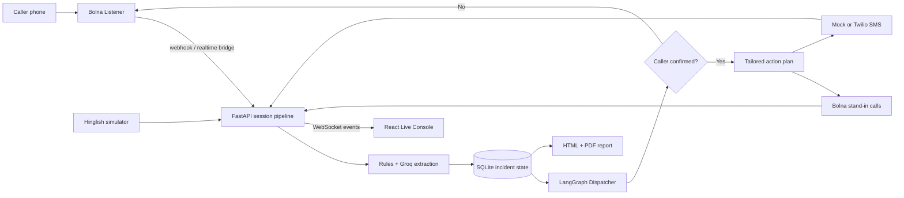

# Architecture

## One pipeline, three inputs

Bolna webhooks, the manual transcript endpoint, and the simulator all call the same `IncidentOrchestrator.process_transcript` method. It extracts facts, applies correction-safe updates, persists the session, emits WebSocket events, and evaluates the Dispatcher graph.

## Safety boundaries

- `DEMO_MODE=true` and `ALLOW_REAL_ACTIONS=false` are the defaults.
- Both settings must explicitly permit real actions.
- `BolnaClient` rejects every recipient outside the configured stand-in allowlist.
- 100, 101, 102, 108, and 112 are blocked inside the network adapter.
- Dispatch requires type, medium-or-higher location confidence, and caller confirmation.
- Outbound calls are rate-limited and retried at most once.
- Stop cancels pending local work and prevents new actions.
- Session deletion removes both the session and its event log.

## LangGraph flow

`ingest_chunk → extract_entities → completeness_check → await_confirmation → plan_actions → execute_actions → report`

Side effects run outside graph nodes so confirmation, allowlists, rate limits, cancellation, and retries remain centralized.

